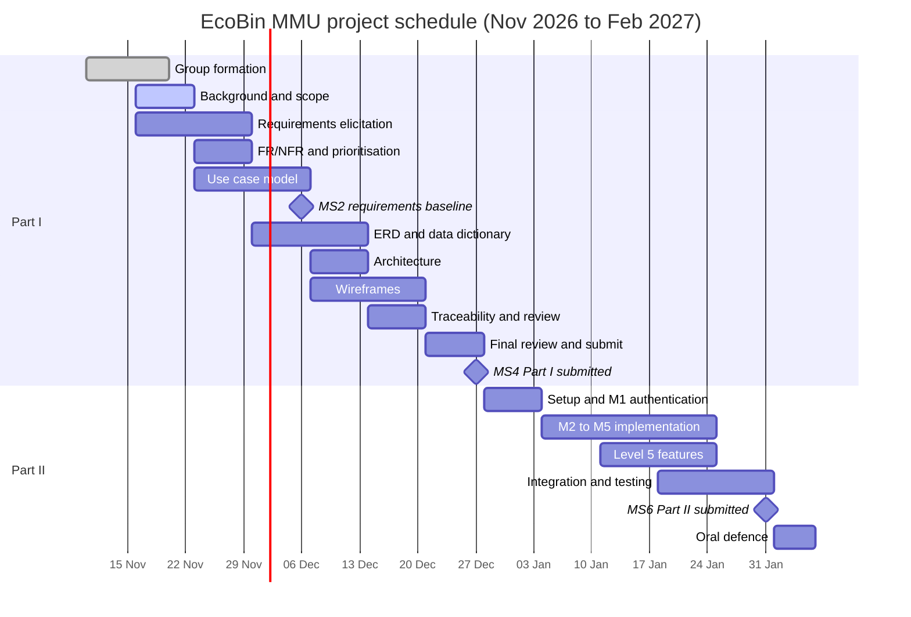
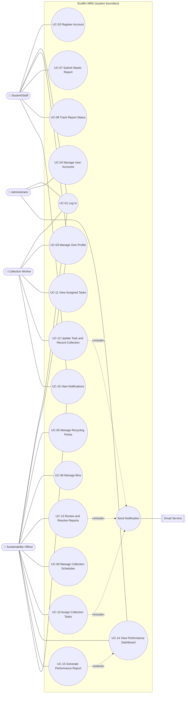
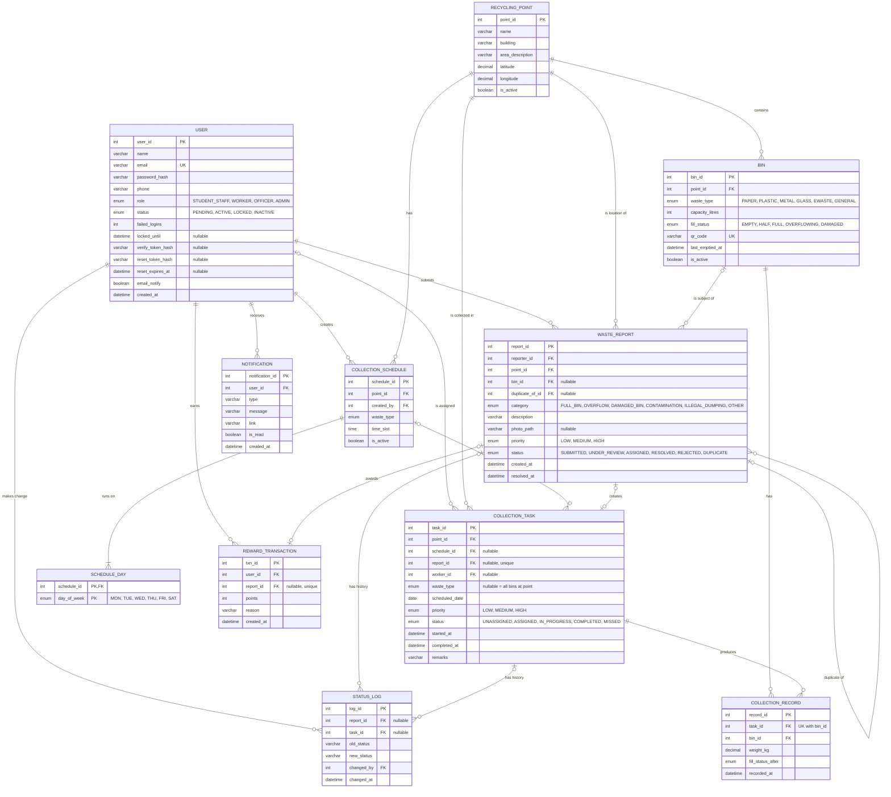
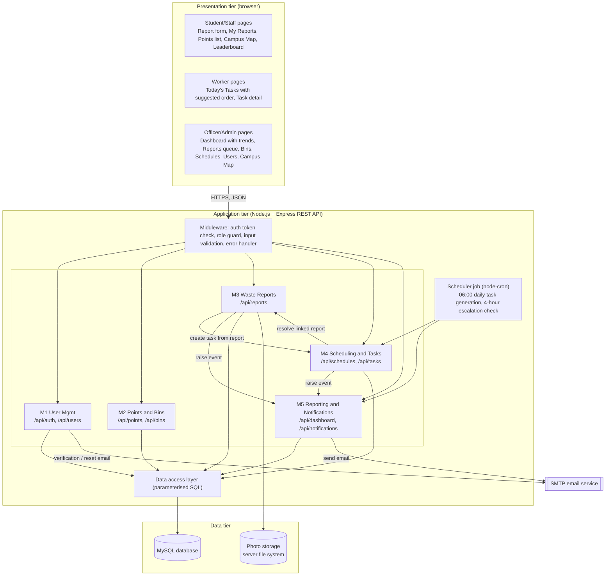
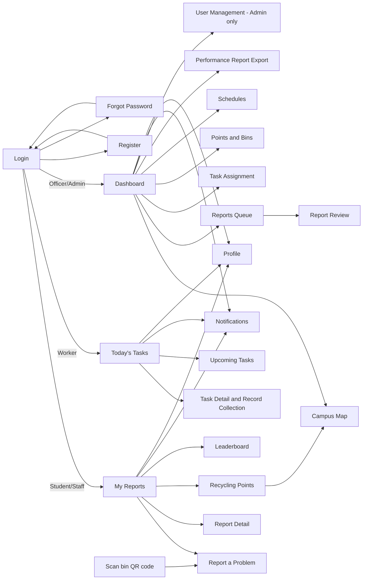

# Software Planning, Requirement and Design
## for Campus Recycling and Waste Collection Management System (EcoBin MMU)

- **Tutorial Group:** TT6L / G[xx]
- **Submission week:** Week 7
- **Version:** 0.5 (draft) / 18/11/2026

| Student name | Student ID | Assigned actor, use cases, diagrams and responsibilities |
|---|---|---|
| Mohammad Adam Hakeem bin Mohd Adha Taufek | 252UC242PM | Project lead. Actor: Administrator. M1 User Management (UC-01 to UC-04), the notification service in M5 (UC-16, FR-29 to FR-31) and Level 5 map/status tracking (OPT-02). Sections 1.1 to 1.5, 5 (architecture) and 7 (traceability). Project setup, final PDF compile. |
| \<Member 2\> | \<student #\> | Actor: Sustainability Officer. M2 Recycling Point and Bin Management (UC-05, UC-06) and the performance reporting part of M5 (UC-14, UC-15, FR-26 to FR-28), plus Level 5 trend analysis (OPT-03). Section 4 (ERD and data dictionary). |
| \<Member 3\> | \<student #\> | Actor: Student/Staff. M3 Waste Reporting and Collection Management (UC-07, UC-08, UC-13), plus Level 5 rewards (OPT-01). Section 2 (system overview), 3.2 use case diagram, 8 (references). Requirements survey. |
| \<Member 4\> | \<student #\> | Actor: Collection Worker. M4 Collection Scheduling and Assignment (UC-09 to UC-12), plus Level 5 route optimisation (OPT-04). Section 1.6 (Gantt chart, risks) and 6 (wireframes and navigation flow). |

> Draft note: group members, group number and IDs are placeholders until the group is formed (deadline 20/11/2026). Each member also writes the FRs, NFRs and use case descriptions for their own modules (Section 3) and their own weekly AI tracker entry (Section 9). M5 is split in two: Adam owns notifications and Member 2 owns the dashboard and export, so that everyone has a similar amount of code to defend in Part II.

## Contents
- [Revision History](#revision-history)
- [1 Project Introduction and Planning](#1-project-introduction-and-planning)
  - [1.1 Background](#11-background)
  - [1.2 Problem Statement](#12-problem-statement)
  - [1.3 Target Users](#13-target-users)
  - [1.4 Scope and Exclusions](#14-scope-and-exclusions)
  - [1.5 Development Process](#15-development-process)
  - [1.6 Project Schedule](#16-project-schedule)
- [2 System Overview](#2-system-overview)
  - [2.1 Description](#21-description)
  - [2.2 Actors](#22-actors)
  - [2.3 Assumptions and Dependencies](#23-assumptions-and-dependencies)
- [3 Requirements Specification](#3-requirements-specification)
  - [3.1 Functional and Non-Functional Requirements](#31-functional-and-non-functional-requirements)
  - [3.2 Use Case Model](#32-use-case-model)
- [4 Logical Database Design](#4-logical-database-design)
  - [4.1 ERD](#41-erd)
  - [4.2 Entities](#42-entities)
- [5 High-level System Architecture](#5-high-level-system-architecture)
- [6 Preliminary User Interface Design](#6-preliminary-user-interface-design)
- [7 Traceability and Consistency](#7-traceability-and-consistency)
- [8 References](#8-references)
- [9 Weekly Progress Monitoring](#9-weekly-progress-monitoring)

## Revision History

| Version | Date | Author(s) | Description of Version |
|---|---|---|---|
| 0.1 | 18/11/2026 | Adam | First full draft of all sections for group review. Members 2 to 4 still placeholders. |
| 0.2 | 18/11/2026 | Adam | ERD fixes: optional worker on task, point may have no bins, SCHEDULE_DAY table for 1NF, STATUS_LOG real FKs, task waste type, lockout and token columns, enum values filled in. |
| 0.3 | 18/11/2026 | Adam | Rebalanced work: M5 split (notifications to Adam, dashboard/export to Member 2); report sections assigned per member. |
| 0.4 | 18/11/2026 | Adam | Checked against the official template and project description. Added route optimisation (OPT-04) so all four Level 5 features from the brief are covered, one per member. Use case headings numbered 3.2.x as in the template. |
| 0.5 | 18/11/2026 | Adam | Made the whole report consistent with the work split: Level 5 features added to task breakdown, Gantt chart, system overview, ERD (REWARD_TRANSACTION), architecture, navigation flow, screen list and traceability. |

---

## 1 Project Introduction and Planning

### 1.1 Background
MMU Cyberjaya has recycling bins spread across faculty buildings, hostels, the library and the cafeterias. Today, bins are emptied on a fixed routine by the cleaning contractor, and problems such as an overflowing bin or a dumped pile of boxes are reported informally, usually by telling a guard or a cleaner, or not at all. The campus sustainability office has no single record of how much is recycled, which bins fill up fastest, or how quickly reported problems get fixed.

EcoBin MMU is a web application that brings this into one place. Students and staff can find recycling points and report waste problems. Sustainability officers manage bins and schedules and assign collection work. Collection workers see their tasks for the day and record what they collected. The data collected along the way feeds simple recycling performance reports.

### 1.2 Problem Statement
Waste collection on campus is run on a fixed routine with no feedback from the people using the bins. Full or damaged bins stay that way until the next round, reports from students get lost because there is no channel for them, and the sustainability office cannot measure recycling volumes or collection response times. The project aims to give the campus a single system for reporting, scheduling, assigning and recording waste collection, so that problems are fixed faster and recycling performance can be measured.

### 1.3 Target Users
- **Students and staff** of MMU Cyberjaya who use the recycling bins and want to report problems or check where to recycle.
- **Collection workers** (cleaning contractor staff) who empty bins and handle reported issues.
- **Sustainability officers** from the campus facilities or sustainability unit who plan collections and monitor performance.
- **System administrators** who manage accounts and system settings.

### 1.4 Scope and Exclusions

**In scope (mandatory core modules)**

| Module | Included functions |
|---|---|
| M1 User Management | Registration with MMU email, login/logout, role-based access, profile update, password reset, admin account management (activate, deactivate, change role) |
| M2 Recycling Point and Bin Management | Add, edit and deactivate recycling points (building, location, description); add, edit and deactivate bins at each point (waste type, capacity, fill status, QR code) |
| M3 Waste Reporting and Collection Management | Report a waste issue with category, description and photo; track report status; officer reviews, prioritises and resolves reports; duplicate reports closed as duplicates, not deleted |
| M4 Collection Scheduling and Assignment | Create recurring collection schedules per point and waste type; generate daily collection tasks; assign tasks to workers; workers update task status and record collected weight |
| M5 Recycling Performance Reporting and Notifications | Dashboard and reports on collected weight by waste type, point and period; report response times; in-app and email notifications for status changes and assignments |

**Level 5 extensions (the four listed in the project brief; one per member, started after that member's core FRs pass testing)**
- Recycling rewards and points-based recognition for resolved reports (OPT-01, Member 3)
- Interactive recycling location map and collection status tracking (OPT-02, Adam)
- Waste generation trend analysis by week and month (OPT-03, Member 2)
- Collection route optimisation: suggested visiting order for a worker's tasks based on bin locations (OPT-04, Member 4)

**Excluded**
- Real IoT fill-level sensors. Fill status is updated manually by workers and through reports.
- Turn-by-turn navigation or live GPS tracking of workers. Route optimisation (OPT-04) only orders the stops.
- Native mobile apps. The web app will be responsive instead.
- Payment, contractor billing or payroll.
- Integration with MMU's real student information system or CAMSYS login. Registration uses MMU email addresses only.

### 1.5 Development Process
We will use an **incremental model with weekly iterations**, run in a light Scrum style (weekly planning on Monday, a short check-in mid-week, a review with the tutor during the tutorial).

Reasons for this choice:
- The project has two hard submission points. Part I (Week 7) needs stable requirements and design, and Part II (Week 12) needs working software. An incremental model lets us fix the requirements baseline in Part I and then build and test one module increment at a time in Part II.
- Each member owns one or two modules, so increments map cleanly to people. Modules can be built in parallel once the shared database schema and the authentication module (M1) are in place.
- The weekly AI Thought Partner Tracker and tutor check-ins already give a weekly rhythm, so weekly iterations fit the course.
- A pure waterfall model would leave no time to react to tutor feedback on the design. A full Scrum process with daily stand-ups is too heavy for a four-person student team with other courses.

### 1.6 Project Schedule

**Work breakdown and responsibility**

| WBS | Task | Owner | Week |
|---|---|---|---|
| 1.1 | Form group, agree on roles and tools (GitHub, Discord) | All | 1–2 |
| 1.2 | Background, problem statement, scope, development process | Adam | 2 |
| 1.3 | Requirements elicitation (short survey of 10+ students, interview with facilities if possible) | Member 3 | 2–3 |
| 1.4 | FR/NFR list and prioritisation | Each member for own modules; Adam merges | 3 |
| 1.5 | Use case diagram and use case descriptions | Member 3 (diagram, Section 2), each member (own UCs) | 3–4 |
| 1.6 | ERD and data dictionary | Member 2 | 4–5 |
| 1.7 | System architecture | Adam | 5 |
| 1.8 | Wireframes and navigation flow | Member 4 | 5–6 |
| 1.9 | Traceability table and consistency check | Adam | 6 |
| 1.9a | Gantt chart and risk register (kept updated weekly) | Member 4 | 2–7 |
| 1.9b | References and citation check | Member 3 | 6 |
| 1.10 | Final review, PDF export, submission | All | 7 |
| 2.1 | Project setup, M1 authentication and role guard | Adam | 8 |
| 2.1a | Database schema script (from ERD) and seed data | Member 2 | 8 |
| 2.2 | Module implementation: M2 + M5 reporting (Member 2), M3 (Member 3), M4 (Member 4), M5 notifications (Adam) | Module owners | 8–11 |
| 2.2a | Level 5 features: OPT-01 rewards (Member 3), OPT-02 map and status tracking (Adam), OPT-03 trend analysis (Member 2), OPT-04 route optimisation (Member 4) | Feature owners | 10–11 |
| 2.3 | Integration and testing | All | 11–12 |
| 2.4 | Individual reports and oral defence prep | Each member | 12–13 |

**Milestones**

| ID | Milestone | Date |
|---|---|---|
| MS1 | Group formed and roles agreed | 20/11/2026 |
| MS2 | Requirements baseline (FRs, NFRs, use cases) reviewed by tutor | 06/12/2026 (Wk 4) |
| MS3 | Design complete (ERD, architecture, wireframes) | 20/12/2026 (Wk 6) |
| MS4 | Part I submitted | 27/12/2026 (Wk 7) |
| MS5 | Core modules integrated | 24/01/2027 (Wk 11) |
| MS6 | Part II submitted | 31/01/2027 (Wk 12) |
| MS7 | Individual oral defence | 01–05/02/2027 (Wk 13) |

**Gantt chart**



**Project risks**

| ID | Risk | Likelihood | Impact | Mitigation |
|---|---|---|---|---|
| R1 | A member drops the course or stops contributing | Medium | High | Each module has a named backup owner; weekly check-in records who did what in the tracker and Git history |
| R2 | Clashing deadlines from other courses near Weeks 6–7 | High | Medium | Aim to finish design by Week 6 (MS3) so Week 7 is review only |
| R3 | Requirements change after tutor feedback | Medium | Medium | Get the requirements baseline reviewed at MS2; log every change in the Revision History |
| R4 | Merge conflicts or lost work | Medium | Medium | One GitHub repo, feature branches per module, pull requests reviewed by one other member |
| R5 | Scope creep from Level 5 features | Medium | High | Level 5 features (OPT-01 to OPT-04) start only after all core FRs pass testing |
| R6 | Team members unfamiliar with chosen stack | Medium | Medium | Use a stack most members already know (React, Node.js, MySQL); Adam sets up the project skeleton in Week 8 |

---

## 2 System Overview

### 2.1 Description
EcoBin MMU supports five main business processes.

1. **Account and access management (M1).** Students and staff register using their MMU email and log in. The administrator manages all accounts, assigns roles (Student/Staff, Collection Worker, Sustainability Officer, Administrator) and can deactivate accounts. Every page and action is restricted by role.
2. **Recycling point and bin management (M2).** The sustainability officer keeps the list of recycling points (for example "FCI Building Lobby") and the bins at each point, each with a waste type, capacity and current fill status. Each bin gets a QR code that links straight to the report form for that bin.
3. **Waste reporting (M3).** A student or staff member reports a problem such as a full bin, overflow, a damaged bin, contamination or illegal dumping, with an optional photo. The officer reviews the report, sets its priority, and either turns it into a collection task, resolves it directly, or closes it as a duplicate. The reporter can follow the report's status.
4. **Collection scheduling and assignment (M4).** The officer sets recurring schedules (for example paper bins at the library every Monday and Thursday). The system generates collection tasks from schedules each day, and the officer assigns these, along with tasks from urgent reports, to collection workers. Workers see their task list, mark tasks as in progress or completed, and record the weight collected per bin.
5. **Performance reporting and notifications (M5).** The system turns collection records and reports into dashboards showing weight collected by waste type, point and period, open and overdue tasks, and average report response time. Users get in-app and email notifications when a report changes status or a task is assigned.

On top of these core processes, the system adds the four Level 5 features from the project brief: reward points and a leaderboard for students whose reports are resolved (OPT-01), a campus map showing each point's bin and collection status (OPT-02), trend analysis of waste collected (OPT-03), and a suggested visiting order for each worker's daily tasks (OPT-04).

### 2.2 Actors

| Actor | Use Cases |
|---|---|
| Student/Staff | UC-01 Log In, UC-02 Register Account, UC-03 Manage Own Profile, UC-07 Submit Waste Report, UC-08 Track Report Status, UC-16 View Notifications |
| Collection Worker | UC-01 Log In, UC-03 Manage Own Profile, UC-11 View Assigned Tasks, UC-12 Update Task and Record Collection, UC-16 View Notifications |
| Sustainability Officer | UC-01 Log In, UC-03 Manage Own Profile, UC-05 Manage Recycling Points, UC-06 Manage Bins, UC-13 Review and Resolve Reports, UC-09 Manage Collection Schedules, UC-10 Assign Collection Tasks, UC-14 View Performance Dashboard, UC-15 Generate Performance Report, UC-16 View Notifications |
| Administrator | UC-01 Log In, UC-04 Manage User Accounts, UC-14 View Performance Dashboard, plus all officer use cases if needed |
| Email Service (external system) | Sends emails triggered by UC-02, UC-08, UC-10 and UC-13 |

### 2.3 Assumptions and Dependencies
- **A1.** The system covers one campus (MMU Cyberjaya) with up to 30 recycling points, 150 bins, 10 collection workers, 5 officers and around 5,000 registered users.
- **A2.** There are no fill-level sensors. Bin fill status is set by workers after collection and changed to "Full" automatically when a "full bin" report is accepted.
- **A3.** Collected weight is entered manually by workers from a hand-held scale, rounded to 0.1 kg.
- **A4.** Students and staff have an active MMU email address (`@student.mmu.edu.my` or `@mmu.edu.my`). Workers and officers are created by the administrator.
- **A5.** Users access the system from a modern browser (Chrome, Safari, Edge, Firefox) on a laptop or phone with internet access.
- **A6.** Collections happen during working hours (8 am to 6 pm, Monday to Saturday). Tasks are generated each day at 6 am.
- **D1.** The system depends on an SMTP email service (for example Gmail SMTP or a free transactional email tier) for email notifications and password reset.
- **D2.** Built with permitted technologies: React (frontend), Node.js with Express (backend), MySQL (database).
- **D3.** Photo uploads are stored on the server file system for the prototype. A production version would need cloud storage.

---

## 3 Requirements Specification

Priority uses MoSCoW: **M** = Must, **S** = Should, **C** = Could.

### 3.1 Functional and Non-Functional Requirements

**Functional requirements**

| Identifier | Description | Priority | Module |
|---|---|---|---|
| FR-01 | The system shall let a student or staff member register with name, MMU email, phone and password, and shall reject emails outside the MMU domains. | M | M1 |
| FR-02 | The system shall send a verification link to the registered email; the account stays inactive until verified. | S | M1 |
| FR-03 | The system shall let registered users log in with email and password and log out. | M | M1 |
| FR-04 | The system shall lock an account for 15 minutes after 5 failed login attempts in a row. | S | M1 |
| FR-05 | The system shall let users reset a forgotten password through a time-limited email link (valid 30 minutes). | S | M1 |
| FR-06 | The system shall let users view and edit their own name, phone and password. | M | M1 |
| FR-07 | The administrator shall be able to create worker and officer accounts, change any user's role, and activate or deactivate accounts. | M | M1 |
| FR-08 | The system shall restrict each page and API endpoint to the roles allowed to use it. | M | M1 |
| FR-09 | The officer shall be able to add, edit and deactivate recycling points with name, building, floor/area description and map coordinates. | M | M2 |
| FR-10 | The officer shall be able to add, edit and deactivate bins at a point with waste type (paper, plastic, metal, glass, e-waste, general), capacity in litres and fill status (Empty, Half, Full, Overflowing, Damaged). | M | M2 |
| FR-11 | The system shall generate a unique QR code for each bin that opens the report form with the bin pre-selected. | S | M2 |
| FR-12 | All users shall be able to view the list of active recycling points and the waste types accepted at each. | M | M2 |
| FR-13 | Students/staff shall be able to submit a waste report choosing a point (and optionally a bin), a category (Full Bin, Overflow, Damaged Bin, Contamination, Illegal Dumping, Other), a description and an optional photo. | M | M3 |
| FR-14 | The system shall give each report a status of Submitted, Under Review, Assigned, Resolved, Rejected or Duplicate, and record the time of each status change. | M | M3 |
| FR-15 | Reporters shall be able to view a list of their own reports with current status. | M | M3 |
| FR-16 | The officer shall be able to review reports, set priority (Low, Medium, High), and resolve, reject, convert to a collection task, or close as duplicate of another report. | M | M3 |
| FR-17 | The system shall not allow reports or completed tasks to be deleted; they can only be closed. | M | M3 |
| FR-18 | The system shall warn the reporter if an open report with the same bin and category already exists in the last 24 hours. | S | M3 |
| FR-19 | The officer shall be able to create, edit and deactivate recurring collection schedules for a point and waste type, with days of the week and time slot. | M | M4 |
| FR-20 | The system shall generate collection tasks each day from active schedules. | M | M4 |
| FR-21 | The officer shall be able to assign any unassigned task, including tasks created from reports, to an active collection worker, and reassign it before it starts. | M | M4 |
| FR-22 | Collection workers shall be able to view their assigned tasks for today and the next 7 days, sorted by time and priority. | M | M4 |
| FR-23 | Workers shall be able to set a task to In Progress or Completed, or Missed with a reason. | M | M4 |
| FR-24 | When completing a task, the worker shall record the weight (kg) collected per bin and update each bin's fill status. | M | M4 |
| FR-25 | Completing a task created from a report shall automatically set that report to Resolved. | M | M4 |
| FR-26 | The system shall show officers a dashboard with total weight collected by waste type and by point for a chosen date range. | M | M5 |
| FR-27 | The dashboard shall show open reports, overdue tasks (not completed by end of scheduled day) and average report resolution time. | M | M5 |
| FR-28 | The officer shall be able to export a monthly performance report as PDF or CSV. | S | M5 |
| FR-29 | The system shall send an in-app notification, and an email where enabled, when a user's report changes status or a task is assigned to a worker. | M | M5 |
| FR-30 | Users shall be able to view notifications and mark them as read. | M | M5 |
| FR-31 | The system shall notify officers when a High priority report has had no action for 4 working hours. | S | M5 |
| OPT-01 | The system could award reward points to reporters for reports that are resolved (not rejected or duplicate) and show a leaderboard. | C | M3 |
| OPT-02 | The system could show recycling points on an interactive campus map with colour-coded bin status, and let users follow each point's collection status for the day (Scheduled, In Progress, Collected). | C | Map (reads M2, M4) |
| OPT-03 | The system could show weekly and monthly trend charts of waste collected by type, and flag points whose weekly weight rises more than 30% over their 4-week average. | C | M5 |
| OPT-04 | The system could suggest a visiting order for a worker's tasks for the day, using the recycling points' coordinates and a nearest-neighbour ordering starting from the facilities office. | C | M4 |

**Non-functional requirements**

| Identifier | Category | Description |
|---|---|---|
| NFR-01 | Security | Passwords shall be stored as bcrypt hashes (cost factor 10 or higher), never in plain text. |
| NFR-02 | Security | Authenticated sessions shall use signed tokens that expire after 2 hours of inactivity. |
| NFR-03 | Security | All inputs shall be validated on the server; SQL queries shall use parameterised statements. |
| NFR-04 | Security | Photo uploads shall be limited to JPG or PNG, maximum 5 MB. |
| NFR-05 | Performance | Main pages (task list, report form, dashboard) shall load within 3 seconds with 50 concurrent users in the test environment. |
| NFR-06 | Performance | Notifications shall appear in-app within 1 minute of the triggering event. |
| NFR-07 | Usability | A student shall be able to submit a waste report in no more than 4 steps and under 1 minute (measured in a usability test with 5 students). |
| NFR-08 | Usability | All pages shall be usable on screens from 360 px wide (phones) to 1920 px. |
| NFR-09 | Reliability | Every status change on reports and tasks shall be stored with user and timestamp so the history can be audited. |
| NFR-10 | Reliability | The database shall be backed up daily; a failed task completion shall not leave partial weight records (single transaction). |
| NFR-11 | Maintainability | The backend shall be split into one module per subsystem (M1 to M5) with a shared data access layer. |

### 3.2 Use Case Model

**Use case diagram**



> Note for the final PDF: redraw this in draw.io or StarUML with proper stick-figure actors and ovals. Mermaid has no native UML use case shapes. All use cases except UC-02 require the actor to be logged in (UC-01).

#### 3.2.1 Use Case 1: Log In

| Field | | Details |
|---|---|---|
| **Use Case ID** | | **UC-01** |
| Actors | | Student/Staff, Collection Worker, Sustainability Officer, Administrator |
| Trigger | | User opens the system and clicks **Log In**. |
| Preconditions | | User has an active, verified account. |
| Normal Flow | Description | 1. User enters email and password and clicks **Log In**.<br>2. System checks the account exists, is active and the password matches.<br>3. System creates a session and records the login time.<br>4. System redirects the user to the home page for their role (Student: My Reports; Worker: Today's Tasks; Officer/Admin: Dashboard). |
| | Postconditions | User is logged in with a session that expires after 2 hours of inactivity. |
| Alternative flows and exceptions | | **A1 Wrong password:** at step 2 the system shows "Incorrect email or password" and increments the failed-attempt count. After 5 failures the account is locked for 15 minutes (FR-04).<br>**A2 Account inactive or unverified:** system shows a message and offers to resend the verification email.<br>**A3 Forgot password:** user clicks **Forgot password**, enters email, and the system sends a reset link (FR-05). |
| Non-functional requirements | | NFR-01, NFR-02, NFR-03 |

#### 3.2.2 Use Case 2: Submit Waste Report

| Field | | Details |
|---|---|---|
| **Use Case ID** | | **UC-07** |
| Actors | | Student/Staff |
| Trigger | | User clicks **Report a Problem**, or scans a bin's QR code. |
| Preconditions | | User is logged in (UC-01). At least one active recycling point exists. |
| Normal Flow | Description | 1. System shows the report form. If opened from a QR code, the point and bin are pre-filled.<br>2. User selects the recycling point and, optionally, the bin.<br>3. User selects a category and types a short description (max 500 characters).<br>4. User optionally attaches a photo.<br>5. User clicks **Submit**.<br>6. System validates the input, saves the report with status Submitted and a timestamp, and shows a reference number.<br>7. System notifies officers of the new report (include: Send Notification). |
| | Postconditions | A new report exists with status Submitted and appears in the reporter's My Reports and the officer's review queue. |
| Alternative flows and exceptions | | **A1 Possible duplicate:** at step 5, if an open report for the same bin and category exists from the last 24 hours, the system shows it and asks "Submit anyway?" The user can cancel or continue (FR-18).<br>**E1 Invalid photo:** if the file is not JPG/PNG or is over 5 MB, the system rejects it and keeps the other fields filled in.<br>**E2 Missing fields:** system highlights the missing point or category and does not submit. |
| Non-functional requirements | | NFR-04, NFR-07, NFR-08, NFR-09 |

#### 3.2.3 Use Case 3: Review and Resolve Reports

| Field | | Details |
|---|---|---|
| **Use Case ID** | | **UC-13** |
| Actors | | Sustainability Officer |
| Trigger | | Officer opens the **Reports** queue, or clicks a new-report notification. |
| Preconditions | | Officer is logged in. At least one report has status Submitted or Under Review. |
| Normal Flow | Description | 1. System lists open reports, newest and highest priority first.<br>2. Officer opens a report and sees details, photo and the bin's recent history.<br>3. Officer sets status to Under Review and sets priority.<br>4. Officer chooses **Create Collection Task**.<br>5. System creates a task linked to the report and point, sets the report to Assigned once the task is assigned (UC-10), and notifies the reporter. |
| | Postconditions | Report has a priority and a linked task, and the status change is logged with officer and time. |
| Alternative flows and exceptions | | **A1 Resolve directly:** at step 4 the officer marks the report Resolved with a note (for example the bin was already emptied).<br>**A2 Duplicate:** officer selects the original report; the system sets status Duplicate and links the two. The report is kept, not deleted (FR-17).<br>**A3 Reject:** officer rejects with a reason (for example not on campus). Reporter is notified.<br>**E1 Report already handled:** if another officer changed the report meanwhile, the system shows the latest status and asks the officer to reload. |
| Non-functional requirements | | NFR-06, NFR-09 |

#### 3.2.4 Use Case 4: Assign Collection Tasks

| Field | | Details |
|---|---|---|
| **Use Case ID** | | **UC-10** |
| Actors | | Sustainability Officer |
| Trigger | | Officer opens **Task Assignment** for a date. |
| Preconditions | | Officer is logged in. Unassigned tasks exist for that date (generated from schedules by FR-20 or created from reports in UC-13). At least one worker is active. |
| Normal Flow | Description | 1. System shows unassigned tasks for the date, with point, waste type, priority and time slot, and the list of active workers with how many tasks each already has.<br>2. Officer selects one or more tasks and a worker.<br>3. Officer clicks **Assign**.<br>4. System saves the assignment, sets task status to Assigned, and notifies the worker (include: Send Notification). |
| | Postconditions | Selected tasks are assigned to the worker and appear in the worker's task list (UC-11). |
| Alternative flows and exceptions | | **A1 Reassign:** officer selects a task that is Assigned but not yet In Progress and picks another worker. The system notifies both workers.<br>**E1 Task already started:** system blocks reassignment of tasks In Progress or Completed.<br>**E2 Worker deactivated:** system hides inactive workers and flags their open tasks as unassigned. |
| Non-functional requirements | | NFR-05, NFR-06, NFR-09 |

#### 3.2.5 Use Case 5: Update Task and Record Collection

| Field | | Details |
|---|---|---|
| **Use Case ID** | | **UC-12** |
| Actors | | Collection Worker |
| Trigger | | Worker arrives at a recycling point and opens the task from **Today's Tasks**. |
| Preconditions | | Worker is logged in. The task is assigned to this worker and its status is Assigned or In Progress. |
| Normal Flow | Description | 1. Worker taps **Start**. System sets status to In Progress and records the start time.<br>2. System lists the bins covered by the task.<br>3. For each bin, the worker enters the weight collected (kg) and the bin's fill status after collection.<br>4. Worker taps **Complete**.<br>5. System saves all weight records and bin updates in one transaction, sets the task to Completed with a timestamp, and, if the task came from a report, sets that report to Resolved (FR-25).<br>6. System notifies the officer and, where relevant, the reporter. |
| | Postconditions | Collection records exist for each bin, bin fill status is updated, and the task is Completed. |
| Alternative flows and exceptions | | **A1 Bin damaged:** at step 3 the worker sets status Damaged and adds a note; the system creates a High priority report for the officer.<br>**A2 Missed:** worker cannot complete (for example area locked) and selects **Missed** with a reason. The task goes back to the officer's unassigned list for the next day.<br>**E1 Invalid weight:** weight less than 0 or above 500 kg is rejected.<br>**E2 Connection lost:** nothing is saved until step 5 succeeds; the form keeps the entered values for retry (NFR-10). |
| Non-functional requirements | | NFR-05, NFR-08, NFR-09, NFR-10 |

#### 3.2.6 Other use cases (brief)

| ID | Name | Actor | Summary |
|---|---|---|---|
| UC-02 | Register Account | Student/Staff | Fill in registration form with MMU email; system sends verification email (FR-01, FR-02). |
| UC-03 | Manage Own Profile | All | View and update name, phone, password, email notification setting (FR-06). |
| UC-04 | Manage User Accounts | Administrator | Search users, create worker/officer accounts, change role, activate/deactivate (FR-07). |
| UC-05 | Manage Recycling Points | Officer | Add, edit, deactivate points (FR-09, FR-12). |
| UC-06 | Manage Bins | Officer | Add, edit, deactivate bins, print QR codes (FR-10, FR-11). |
| UC-08 | Track Report Status | Student/Staff | View own reports and status history (FR-14, FR-15). |
| UC-09 | Manage Collection Schedules | Officer | Create, edit, deactivate recurring schedules (FR-19, FR-20). |
| UC-11 | View Assigned Tasks | Worker | See today's and upcoming tasks (FR-22). |
| UC-14 | View Performance Dashboard | Officer, Admin | Weight by type/point, open reports, overdue tasks, response time (FR-26, FR-27). |
| UC-15 | Generate Performance Report | Officer | Export monthly report as PDF/CSV (FR-28). |
| UC-16 | View Notifications | All | List and mark notifications as read (FR-29, FR-30). |

---

## 4 Logical Database Design

### 4.1 ERD



> Note for the final PDF: export this as an image, or redraw in draw.io with crow's foot notation.

### 4.2 Entities

| Entity | Description |
|---|---|
| USER | Every person who uses the system. A single table with a `role` column is used instead of separate tables per actor, because all roles share the same login fields and the role-specific data is small. Email is unique. `locked_until` supports the login lockout (FR-04); the token hash columns support email verification (FR-02) and password reset (FR-05). |
| RECYCLING_POINT | A physical location on campus where one or more bins are placed. Points are deactivated, not deleted, so that old reports and records stay valid. |
| BIN | A single container at a point for one waste type. A point can have zero or more bins (1:M, optional), since a new point is saved before its bins are added. `fill_status` is the latest known status. `qr_code` is unique and used by FR-11. |
| WASTE_REPORT | A problem raised by a student or staff member about a point, and optionally a specific bin. `duplicate_of_id` is a self-reference used when the report is closed as a duplicate. Reports are never deleted (FR-17). |
| COLLECTION_SCHEDULE | A recurring plan to collect a waste type at a point in a time slot. Created by an officer. |
| SCHEDULE_DAY | The days a schedule runs, one row per day (for example two rows, MON and THU). Kept as a separate table so that `days_of_week` is not stored as a comma list, which would break first normal form and make the daily task query harder. |
| COLLECTION_TASK | A single job for one point on one date. It comes either from a schedule (`schedule_id`) or from a report (`report_id`), and at least one of these must be set. A report creates at most one task (1:0..1). `worker_id` is empty until assigned, so a task has zero or one worker. `waste_type` limits which bins at the point the task covers; if empty, the task covers every active bin at the point. |
| COLLECTION_RECORD | The weight collected from one bin during one task. This is the main source for the performance reports in M5. One task produces many records, at most one per bin (`task_id` + `bin_id` unique). |
| NOTIFICATION | A message to one user about a status change or assignment, shown in-app and optionally emailed. |
| REWARD_TRANSACTION | Points given to a user (OPT-01). One row per award, normally for a report that ends Resolved (at most one award per report). A user's total and the leaderboard are worked out by summing this table, so there is no separate points column to keep in sync. |
| STATUS_LOG | Audit trail of every status change on reports and tasks, with who made it and when (NFR-09). Used to compute average resolution time (FR-27). It has two nullable foreign keys, `report_id` and `task_id`, with exactly one set, so the database can enforce that every log row points to a real record. |

**Data assumptions and constraints**
- All primary keys are auto-increment integers. Foreign keys use `ON DELETE RESTRICT`, because the design deactivates records instead of deleting them.
- `CHECK (schedule_id IS NOT NULL OR report_id IS NOT NULL)` on COLLECTION_TASK.
- `CHECK ((report_id IS NULL) <> (task_id IS NULL))` on STATUS_LOG, so exactly one is set.
- `CHECK (weight_kg >= 0 AND weight_kg <= 500)` on COLLECTION_RECORD.
- `bin_id` on WASTE_REPORT must belong to the same `point_id` (enforced in the application layer).
- The tables are in third normal form. Report and task totals are calculated by query, not stored, so they cannot go out of sync.

---

## 5 High-level System Architecture

EcoBin MMU uses a three-tier architecture: a React single-page application, a Node.js/Express REST API split into one module per subsystem, and a MySQL database.



**Subsystem ownership and interaction**

| Subsystem | Owner | Provides | Uses |
|---|---|---|---|
| M1 User Management | Adam | Login, token issue and check, role guard used by all other modules | Email service |
| M2 Recycling Point and Bin Management | Member 2 | Point and bin data, QR codes, bin status updates | M1 (auth) |
| M3 Waste Reporting | Member 3 | Report create/review/close; "create task from report" call to M4 | M1, M2 (point/bin lookup), M4, M5 notifications |
| M4 Collection Scheduling and Assignment | Member 4 | Schedules, task generation, assignment, collection records; "resolve report" call to M3 | M1, M2 (bin list, fill status), M3, M5 notifications |
| M5 Reporting (dashboard and export) | Member 2 | Dashboard queries, PDF/CSV export | Reads data from M2 to M4 |
| M5 Notifications | Adam | Notification creation, in-app list, email sending, 4-hour escalation job | Events from M3 and M4; email service |
| Level 5: OPT-01 Rewards | Member 3 | Award points when a report is resolved, leaderboard | M3 events |
| Level 5: OPT-02 Campus Map and Status Tracking | Adam | Map page with points, bin fill status and today's collection status | Reads M2 (points, bins) and M4 (tasks) |
| Level 5: OPT-03 Trend Analysis | Member 2 | Weekly/monthly trend charts, spike flags | Reads collection records (M4) |
| Level 5: OPT-04 Route Optimisation | Member 4 | Suggested visiting order for a worker's daily tasks | Point coordinates (M2), tasks (M4) |

**Design rationale**
- **Three tiers** keep the UI separate from business rules and data, so each member can work on their module's API and pages without touching other modules' code.
- **One backend module per subsystem** matches module ownership, which makes individual contribution clear for the Part II oral defence and keeps merge conflicts small.
- **REST with JSON** is simple to test with Postman and to call from React.
- **Notifications go through M5 only.** Other modules raise an event (for example `report.statusChanged`) and M5 decides who to notify, so notification logic is in one place.
- **Shared data access layer** enforces parameterised queries (NFR-03) and lets the transaction for task completion (NFR-10) be handled in one place.
- **Stack choice** (React, Express, MySQL) is from the permitted list and is the stack most of the group already knows.

---

## 6 Preliminary User Interface Design

**Navigation flow**



**Wireframe 1: Report a Problem (UC-07, Student/Staff, mobile)**

```
┌──────────────────────────────┐
│ ☰  EcoBin MMU          🔔 2  │
├──────────────────────────────┤
│ Report a Problem             │
│                              │
│ Recycling point *            │
│ [ FCI Building Lobby     ▼ ] │ ← pre-filled when opened from QR code
│ Bin (optional)               │
│ [ Plastic - B-014        ▼ ] │
│ Category *                   │
│ ( ) Full bin  (•) Overflow   │
│ ( ) Damaged   ( ) Dumping    │
│ ( ) Contamination ( ) Other  │
│ Description                  │
│ [ Bags piled next to bin...] │ ← max 500 characters
│ Photo                        │
│ [ 📷 Take / upload photo ]   │ ← JPG/PNG, max 5 MB
│                              │
│ [        SUBMIT REPORT     ] │
└──────────────────────────────┘
 After submit: "Report #R-1042 submitted" + link to My Reports
```

**Wireframe 2: Reports Queue and Review (UC-13, Officer, desktop)**

```
┌──────────────────────────────────────────────────────────────────────┐
│ EcoBin MMU  | Dashboard | Reports | Tasks | Points & Bins | Schedules │
├──────────────────────────────────────────────────────────────────────┤
│ Reports queue   Filter: [Open ▼] [All points ▼] [Priority ▼]  🔍     │
│ ┌────┬──────────────┬───────────┬──────────┬─────────┬────────────┐ │
│ │ ID │ Point        │ Category  │ Priority │ Status  │ Submitted  │ │
│ ├────┼──────────────┼───────────┼──────────┼─────────┼────────────┤ │
│ │1042│ FCI Lobby    │ Overflow  │  HIGH ●  │Submitted│ 10:12 today│ │
│ │1041│ Library L1   │ Full bin  │  MED  ●  │Review   │ 09:40 today│ │
│ └────┴──────────────┴───────────┴──────────┴─────────┴────────────┘ │
│ ── Report #1042 ───────────────────────────────────────────────────  │
│ [ photo ]  Reporter: Ali (student)   Bin: B-014 Plastic              │
│            "Bags piled next to bin..."                               │
│ Priority: [High ▼]                                                   │
│ [Create collection task] [Resolve] [Mark duplicate of #__] [Reject]  │
│ Status history: Submitted 10:12 → Under Review 10:20 (Officer Siti)  │
└──────────────────────────────────────────────────────────────────────┘
```

**Wireframe 3: Today's Tasks and Record Collection (UC-11, UC-12, Worker, mobile)**

```
┌──────────────────────────────┐   ┌──────────────────────────────┐
│ Today's Tasks   Wed 13 Jan   │   │ ← Task T-311  IN PROGRESS    │
├──────────────────────────────┤   ├──────────────────────────────┤
│ 🔴 HIGH  FCI Lobby           │   │ FCI Building Lobby           │
│    From report #1042  10:30  │──▶│ Bin B-014 Plastic            │
│    [ Start ]                 │   │  Weight (kg) [ 6.4 ]         │
│ ⚪ Library L1 - Paper 11:00  │   │  Status after [ Empty ▼ ]    │
│    Scheduled   [ Start ]     │   │ Bin B-015 Paper              │
│ ⚪ Cafeteria - General 14:00 │   │  Weight (kg) [ 3.1 ]         │
│    Scheduled   [ Start ]     │   │  Status after [ Empty ▼ ]    │
│                              │   │ Remarks [               ]    │
│ 3 tasks · 0 completed        │   │ [ Missed ]   [ COMPLETE ]    │
└──────────────────────────────┘   └──────────────────────────────┘
```

**Wireframe 4: Performance Dashboard (UC-14, Officer/Admin, desktop)**

```
┌──────────────────────────────────────────────────────────────────────┐
│ Dashboard        Date range: [01/01/2027] – [31/01/2027]  [Export ▼] │
├───────────────┬───────────────┬───────────────┬──────────────────────┤
│ Collected     │ Open reports  │ Overdue tasks │ Avg resolution time  │
│ 1,284.5 kg    │ 12            │ 3             │ 5.2 hours            │
├───────────────┴───────────────┴───────────────┴──────────────────────┤
│ Weight by waste type (bar)        │ Top 5 points by weight (table)   │
│ Paper   ████████████ 520 kg       │ 1. Library L1       310 kg       │
│ Plastic ████████ 360 kg           │ 2. FCI Lobby        205 kg       │
│ Metal   ███ 120 kg                │ 3. Cafeteria        190 kg       │
│ Glass   ██ 84 kg                  │ ...                              │
│ General ████ 200 kg               │                                  │
└───────────────────────────────────┴──────────────────────────────────┘
 Export ▼ → Monthly report (PDF) / Raw data (CSV)   (UC-15)
```

| Screen | Use cases | Owner |
|---|---|---|
| Login, Register, Forgot Password, Profile | UC-01, UC-02, UC-03 | Adam |
| User Management | UC-04 | Adam |
| Points and Bins, Recycling Points list | UC-05, UC-06 | Member 2 |
| Report a Problem, My Reports, Report Detail, Reports Queue, Report Review | UC-07, UC-08, UC-13 | Member 3 |
| Schedules, Task Assignment, Today's Tasks, Task Detail | UC-09 to UC-12 | Member 4 |
| Dashboard, Export | UC-14, UC-15 | Member 2 |
| Notifications | UC-16 | Adam |
| Campus Map (OPT-02) | Recycling Points list, UC-11 | Adam |
| Trend charts on Dashboard (OPT-03) | UC-14 | Member 2 |
| Leaderboard, points on My Reports (OPT-01) | UC-08 | Member 3 |
| Suggested order on Today's Tasks (OPT-04) | UC-11 | Member 4 |

> Note for the final PDF: these text wireframes are placeholders. Redraw them in Figma or draw.io and keep the annotations.

---

## 7 Traceability and Consistency

| Requirement | Use case | Data entity | Subsystem / screen |
|---|---|---|---|
| FR-01, FR-02 | UC-02 | USER | M1 / Register |
| FR-03, FR-04, FR-05 | UC-01 | USER | M1 / Login, Forgot Password |
| FR-06 | UC-03 | USER | M1 / Profile |
| FR-07 | UC-04 | USER | M1 / User Management |
| FR-08 | All | USER (role) | M1 middleware / all screens |
| FR-09, FR-12 | UC-05 | RECYCLING_POINT | M2 / Points and Bins, Recycling Points |
| FR-10, FR-11 | UC-06 | BIN | M2 / Points and Bins |
| FR-13, FR-18 | UC-07 | WASTE_REPORT, BIN, RECYCLING_POINT | M3 / Report a Problem |
| FR-14, FR-15 | UC-08 | WASTE_REPORT, STATUS_LOG | M3 / My Reports, Report Detail |
| FR-16, FR-17 | UC-13 | WASTE_REPORT, COLLECTION_TASK, STATUS_LOG | M3 / Reports Queue, Report Review |
| FR-19, FR-20 | UC-09 | COLLECTION_SCHEDULE, COLLECTION_TASK | M4 / Schedules, scheduler job |
| FR-21 | UC-10 | COLLECTION_TASK, USER | M4 / Task Assignment |
| FR-22 | UC-11 | COLLECTION_TASK | M4 / Today's Tasks |
| FR-23, FR-24, FR-25 | UC-12 | COLLECTION_TASK, COLLECTION_RECORD, BIN, WASTE_REPORT | M4 / Task Detail |
| FR-26, FR-27 | UC-14 | COLLECTION_RECORD, WASTE_REPORT, COLLECTION_TASK, STATUS_LOG | M5 / Dashboard |
| FR-28 | UC-15 | COLLECTION_RECORD | M5 / Export |
| FR-29, FR-30, FR-31 | UC-16, Send Notification | NOTIFICATION | M5 / Notifications, scheduler job |
| OPT-01 | UC-08, UC-13 | REWARD_TRANSACTION, USER, WASTE_REPORT | M3 / My Reports, Leaderboard |
| OPT-02 | UC-11, UC-12, Recycling Points list | RECYCLING_POINT, BIN, COLLECTION_TASK | Map (reads M2, M4) / Campus Map |
| OPT-03 | UC-14 | COLLECTION_RECORD | M5 / Dashboard trend chart |
| OPT-04 | UC-11 | COLLECTION_TASK, RECYCLING_POINT | M4 / Today's Tasks (suggested order) |
| NFR-01 to NFR-04 | UC-01, UC-07 | USER, WASTE_REPORT | M1 middleware, data access layer |
| NFR-09, NFR-10 | UC-12, UC-13 | STATUS_LOG, COLLECTION_RECORD | Data access layer |

**Consistency check**
- Every FR maps to at least one use case, one entity and one subsystem.
- Every use case in the diagram appears in the actor table (2.2) and the traceability table.
- Every entity in the ERD is used by at least one FR.

**Open issues**
1. Confirm with the tutor whether the Administrator should also be able to do all officer tasks or only manage accounts.
2. Confirm with the tutor how many points each resolved report should earn (OPT-01). The draft assumes a fixed amount per report.
3. Agree on how to host the prototype for the demo (local machine or a free cloud host).

**Implementation priorities for Part II**
1. M1 authentication and role guard, plus the full database schema (Week 8). Every other module depends on these.
2. M2 points and bins (Week 8–9), needed before reports and schedules can be tested.
3. M3 reports and M4 schedules/tasks in parallel (Week 9–10).
4. M5 dashboard and notifications (Week 10–11).
5. Level 5 features (OPT-01 to OPT-04), each by its owner, once their Must requirements pass testing.

---

## 8 References

IEEE (1998) *IEEE Recommended Practice for Software Requirements Specifications* (IEEE Std 830-1998). New York: IEEE.

Multimedia University (2026) *CSE6214 Software Engineering Fundamentals: Project Description, November 2026 (Term 2630)*. Cyberjaya: Multimedia University.

Pressman, R.S. and Maxim, B.R. (2020) *Software Engineering: A Practitioner's Approach*. 9th edn. New York: McGraw-Hill Education.

Sommerville, I. (2016) *Software Engineering*. 10th edn. Harlow: Pearson.

uml-diagrams.org (n.d.) *UML Use Case Diagrams*. Available at: https://www.uml-diagrams.org/use-case-diagrams.html (Accessed: 18 November 2026).

> Add any survey or interview carried out in Week 2–3, and cite any tools used for diagrams (draw.io, Figma, Mermaid).

---

## 9 Weekly Progress Monitoring

### AI Thought Partner Tracker — Week 2

| Tutorial & Group Name | Date |
|---|---|
| TT6L / G[xx] | 18/11/2026 |

**1. What was the task, and why did you decide to use AI to help?**
> Produce a first full draft of the Part I report for the TT6L project so the group has a starting structure to review and divide up.

**2. What prompt(s) did you use?**
> "Draft me a report and push to GitHub as md file" (asked Claude to fill the Part I template for the TT6L Campus Recycling and Waste Collection Management System).

**3. What did the AI tool say?**
> It produced a full draft covering scope, schedule, requirements, use cases, ERD, architecture, wireframes and traceability, with placeholder group members.

**4. What did you think of the output?**
> \<To fill in: what was useful, what was wrong or too generic, what the group changed.\>

**5. What did you do with the output?**
> \<To fill in: which parts the group kept, revised or rewrote.\>

**6. Reflect on the process.**
Tick all that apply and add comments below.

- [ ] I feel like I learned more deeply by using AI
- [ ] I want to get better at prompting
- [ ] I had to do a lot of my own thinking
- [ ] I'm not sure how to tell when the AI tool is wrong
- [ ] I relied too much on the AI

**Comments:**
>
